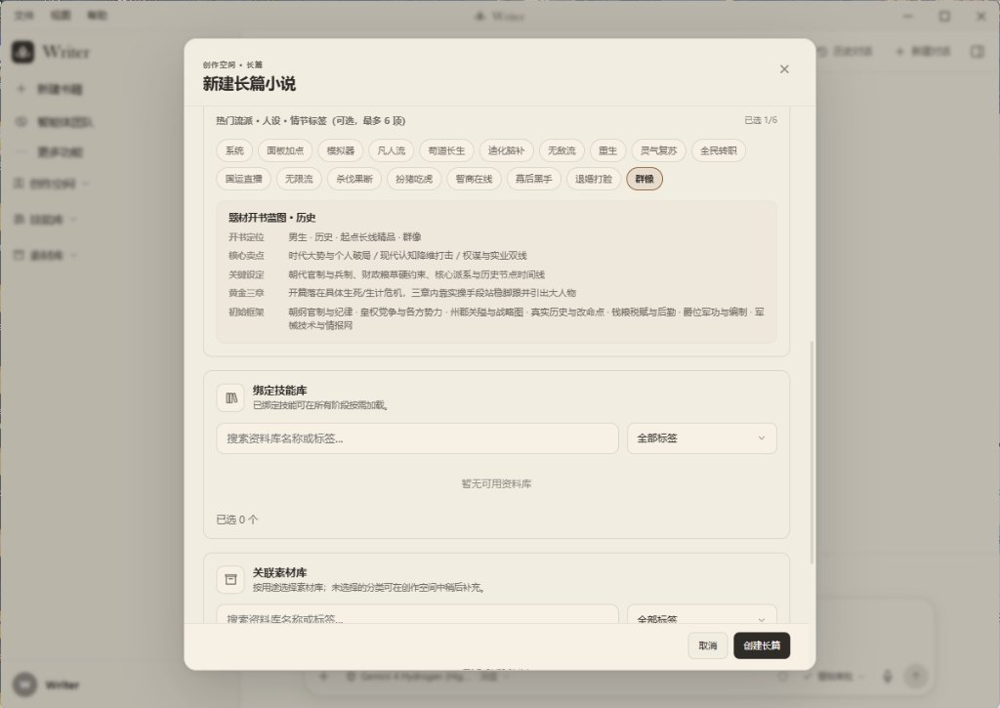
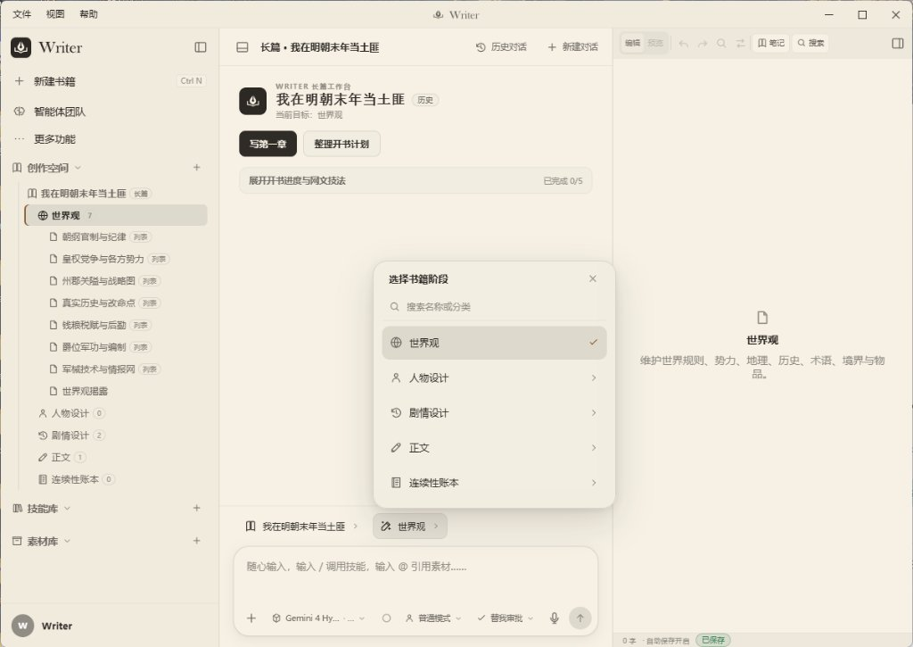
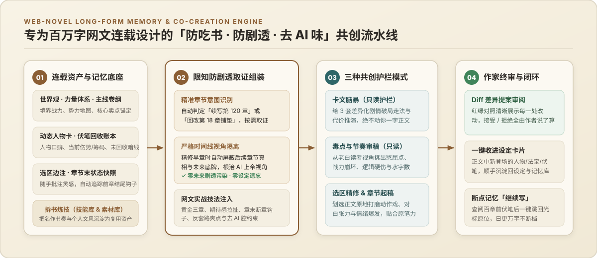
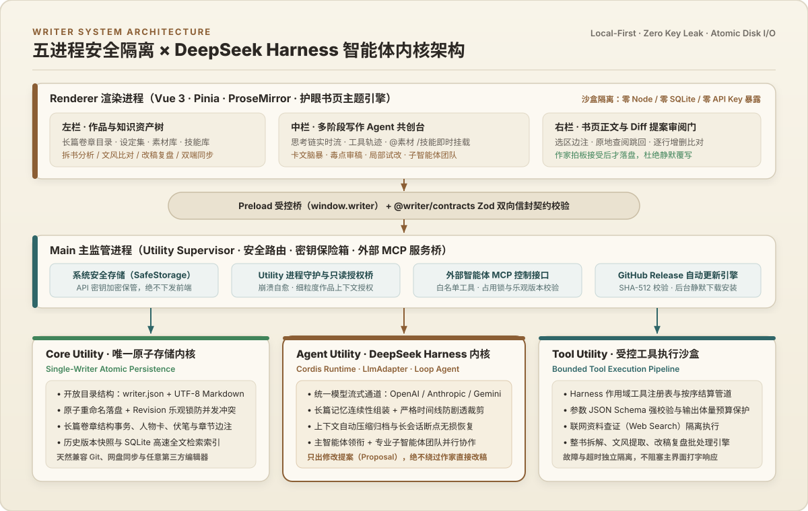

<div align="center">

# Writer

**A Local-First AI Writing Agent Workbench Built Specifically for Web-Novel & Long-Form Fiction Authors**

*Stay in full command of million-word serials — every foreshadowing thread, character arc, and cliffhanger, without losing your voice.*

[](https://github.com/Minglink/Writer/releases/latest)
[](https://github.com/Minglink/Writer/releases/tag/v0.1.7)
[](./packages/agent-runtime/src/dsh)
[](./apps/desktop)
[](./AGENTS.md)
[](./LICENSE)

[简体中文](./README.md) · **English** · [Illustrated Guide (ZH)](./docs/USER_GUIDE.md) · [Download v0.1.7](https://github.com/Minglink/Writer/releases/tag/v0.1.7)

</div>

---

<p align="center">
  
</p>

## Why Writer?

Writing a million-word serialized web novel is fundamentally different from drafting a short article:

- **Continuity breaks at scale**: By chapter 200, subtle items, injuries, power-system rules, and uncollected foreshadowing threads buried in early chapters become nearly impossible to track manually.
- **Generic chat UIs leak spoilers & lose context**: Re-pasting worldbuilding into chat windows wastes time, and revising Chapter 18 when you've already written Chapter 80 often causes generic LLMs to leak future twists ("omniscient spoiler pollution").
- **Silent overwrites ruin authorial voice**: Most AI writing tools overwrite prose with stiff, generic phrasing and offer no line-by-line diff review.
- **Friction connecting existing AI subscriptions**: Authors who already subscribe to mainstream AI platforms shouldn't need fragile third-party proxies just to write inside a dedicated local studio.
- **Eye fatigue during marathon sessions**: Stark white or harsh high-contrast dark screens punish authors writing 5,000–10,000 words a night.

**Writer** is engineered from the ground up to solve these exact problems — combining local-first Markdown storage, direct multi-platform subscription model management, an anti-spoiler long-form continuity engine, book-decomposition craft libraries, a 6-member writers' room, and a mandatory Diff Proposal Gate inside a warm, eye-friendly book-page desktop studio.

---

## What's New in v0.1.7

### 1. Direct Subscription Model Management (9 Platforms + Account Pool Failover)
Connect your existing AI subscriptions directly inside **Settings → Subscription Model Management** without running external proxy servers:

- **9 Supported Platforms**: `Google Antigravity`, `Google Gemini CLI`, `OpenAI Codex (ChatGPT)`, `GitHub Copilot`, `Claude (Pro / Max)`, `Kiro (AWS)`, `Cursor`, `Windsurf`, and `CodeBuddy`.
- **Flexible Sign-In**: Native OAuth / Device Flow login, **read-only local CLI/IDE credential import** (never modifies external files), or manual token paste.
- **Primary-First Account Pool & Live Quota Tracking**: Pin a primary account to preserve Prompt Cache locality across long-form sessions, automatically fail over to healthy backup accounts on `429` rate limits or quota exhaustion, inspect live quota breakdown, and toggle individual models into the global workspace model selector.
- **Local-Only OS Encryption**: OAuth & refresh tokens are encrypted with Electron `SafeStorage` in the Main process only — never exposed to the Renderer and never synced to the cloud.

| Multi-Platform Subscription Pool | Live Quota & Per-Model Toggles |
| :---: | :---: |
|  |  |

<p align="center">
  
</p>

### 2. Five Creation Spaces, Genre Blueprints & 5-Stage Long-Form Workbench
- **5 Dedicated Workspaces**: **Short Fiction**, **Screenplay**, **Long-Form Novel**, **Academic Writing**, and **Murder Mystery (Script Kill)**.
- **Genre & Pacing Blueprints**: 60+ male/female-oriented web-novel tracks, platform pacing presets (fast-paced serial, long-arc progression, character-driven romance), trope tags, live opening blueprints, and instant binding to **Skill** and **Material** libraries.
- **5-Stage Long-Form Flow**: Navigate cleanly across **Worldbuilding (7 dimensions)**, **Characters**, **Plot Design**, **Manuscript**, and **Continuity Ledger**.

| Creation Spaces & Genre Matrix | Pacing Presets & Trope Tags |
| :---: | :---: |
|  |  |
| **Live Genre Blueprint & Library Binding** | **7-Dimension Worldbuilding & Stage Picker** |
|  |  |

---

## Core Capabilities

<p align="center">
  
</p>

- **Long-Form Continuity & Anti-Spoiler Evidence Engine**: Automatically assembles worldbuilding, character cards, foreshadowing ledgers, margin notes, and inverted-pyramid chapter handoffs (`<=1,000` chars) while strictly truncating future timeline spoilers when revising earlier chapters.
- **6-Member Writers' Room & Smooth Mid-Serial Pivot**: Built-in specialist team (`Plot Architect`, `Blind Scene Actor`, `Chapter Writer`, `Read-Only Prose Auditor`, `Continuity Recorder`, `Consistency Reviewer`) with coordinator-first delegation and stage-confirmation gates, plus incremental `AGENTS.md` transitions without rewriting published chapters.
- **Purpose-Built Co-Creation Guardrails**: Switch seamlessly between **Read-Only Brainstorming**, **Read-Only Critique**, and **Selection Rewrite / Chapter Co-Writing**.
- **Book Decomposition & Reusable Craft Skills**: Decompose full-length novels, compare styles, and analyze your own manuscript revisions to distill reusable **Skills** (`/`) and **Materials** (`@`).
- **Mandatory Diff Proposal Gate + 0-Token Numeric Conservation Lock**: Agents never silently overwrite your manuscript. Every proposed edit is presented as an inspectable diff; deterministic guards protect critical numbers, timestamps, and quantities from accidental deletion during local prose rewrites, and Core writes atomically with optimistic revision locking.
- **Book-Page Eye-Care Aesthetics**: Warm slightly-yellowed paper light theme (`#F6F1E4`) and e-reader-inspired low-glare night mode (`#1B1A18` / `#C8C2B6`).

---

## System Architecture

<p align="center">
  
</p>

Writer enforces strict process isolation across five Electron processes (**Renderer**, **Main**, **Core Utility**, **Agent Utility**, and **Tool Utility**) connected via Zod-validated IPC envelopes (`@writer/contracts`), powered by the **DeepSeek Harness** LLM & tool execution seams (`packages/agent-runtime/src/dsh/`).

- **Subscription Pool + BYOK**: Mix directly connected subscription accounts with custom `OpenAI Completions`, `OpenAI Responses`, `Anthropic Messages`, or `Google Generative AI` endpoints, with OS-encrypted credentials (`SafeStorage`) never exposed to the Renderer.
- **Open Local Files + MCP**: Works are stored as `writer.json` + UTF-8 Markdown folders compatible with Git and cloud drives, with an optional bounded **MCP** interface for external coding/writing agents.

---

## Getting Started

Download `Writer-0.1.7-win-x64.exe` (for **Windows 10 / 11 x64**) from [**GitHub Releases**](https://github.com/Minglink/Writer/releases/latest), or run from source (`Node.js >= 24`, `pnpm >= 11`):

```bash
git clone https://github.com/Minglink/Writer.git
cd Writer
pnpm install
pnpm dev
```

Build the Windows x64 installer locally:

```bash
pnpm pack:win
```

---

## License

Licensed under the **[PolyForm Noncommercial License 1.0.0](./LICENSE)** — free for personal creation, study, academic research, and non-commercial use and redistribution; commercial use requires separate authorization.
