<div align="center">

# Writer

**专为网文作家与长篇创作者打造的本地优先 AI 写作 Agent 工作台**

*不替你喧宾夺主，只陪你稳稳驾驭百万字连载的每一个伏笔、人物与断章钩子。*

[](https://github.com/Minglink/Writer/releases/latest)
[](https://github.com/Minglink/Writer/releases/tag/v0.1.8)
[](./packages/agent-runtime/src/dsh)
[](./apps/desktop)
[](./AGENTS.md)
[](./LICENSE)

`#订阅账号直连` · `#五大创作空间` · `#百万字长篇记忆` · `#限知视角防剧透` · `#拆书炼技` · `#Diff可审阅改稿` · `#6角色编剧室` · `#本地优先`

**简体中文** · [English](./README.en.md) · [图文使用教程](./docs/USER_GUIDE.md) · [立即下载 v0.1.8](https://github.com/Minglink/Writer/releases/tag/v0.1.8)

</div>

---

<p align="center">
  
</p>

## 写在前面：为什么要专门给网文作家做一套写作 Agent？

写长篇网文的人，大概都在凌晨两点遇到过这几件让人头疼的事：

- **写长了容易“吃书”**：连载到四十万字，前面随手埋的一枚信物、某个配角的暗伤、上一卷定下的境界代价，翻遍文件夹也找不准原话在哪一章。
- **普通聊天框根本接不住连载上下文**：每次开新对话都要重新喂一遍世界观、人设和大纲；一旦回改前面的章节，AI 还经常开“上帝视角”，把几十章后才揭晓的底牌提前写漏。
- **受不了浓重的“AI 腔”和乱改原稿**：很多工具一上来就把你熬夜磨出来的对白改成四平八稳的总结句，甚至直接覆盖正文，连逐行比对和反悔的余地都没有。
- **模型接入折腾、成本难控**：手里明明已经订阅了主流 AI 平台，写小说时却还要额外买高价中转 API 或折腾本地反代脚本。
- **盯屏十小时眼睛吃不消**：纯白刺眼的底色和冷黑高反差界面，根本不是给日更四千到一万字的文字工作者准备的。

**Writer 就是冲着这些真实痛点做的。**  
它不是那种输一句话吐三千字行活的“代笔玩具”，而是一套**把项目目录、长篇记忆账本、拆书技法库、多智能体编剧室、主流 AI 订阅账号直连与沉浸式书页编辑器焊在一起的专业写作工程台**。你的每一个字都以纯正的 UTF-8 Markdown 留在自己电脑里，AI 的每一次动笔都必须先递交 Diff 提案、由你拍板定夺。

---

## v0.1.8 核心亮点与界面实拍

### 1. 九大 AI 订阅账号原生直连 × 多账号主备自动切号
手里已有 AI 订阅会员，无需额外部署第三方反代？打开左下角 **`设置 → 订阅模型管理`**，直接把现有订阅账号接入 Writer 全局模型池：

- **覆盖 9 大主流平台**：`Google Antigravity`、`Google Gemini CLI`、`OpenAI Codex (ChatGPT)`、`GitHub Copilot`、`Claude 订阅 (Pro / Max)`、`Kiro (AWS)`、`Cursor`、`Windsurf`、`CodeBuddy`。
- **三种无痛接入方式**：原生 OAuth / 设备码登录、本机已登录 CLI / IDE 凭证**只读扫描导入**（绝不修改外部文件）、手动凭证粘贴。
- **主账号优先 + 自动故障切号 + 实时配额看板**：同平台可挂多账号，优先复用主账号保住长篇上下文 Prompt Cache 命中率；遇到 `429` 限流或配额耗尽自动切至备用健康账号，并支持一键刷新配额、按需开关单个模型与设为全局默认。
- **本机加密零外泄**：所有凭证由操作系统级 `SafeStorage` 加密存于主进程本地，不上传、不参与云端同步、前端界面零接触。

| 九大订阅平台与多账号主备池 | 实时配额明细与单模型开关 |
| :---: | :---: |
| 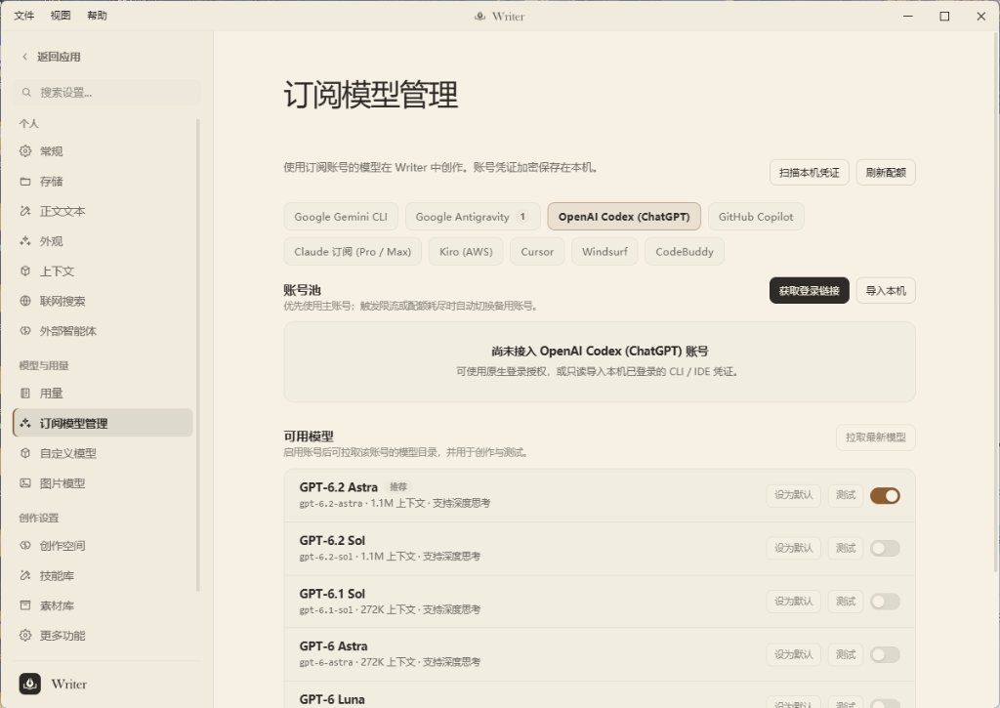 |  |

<p align="center">
  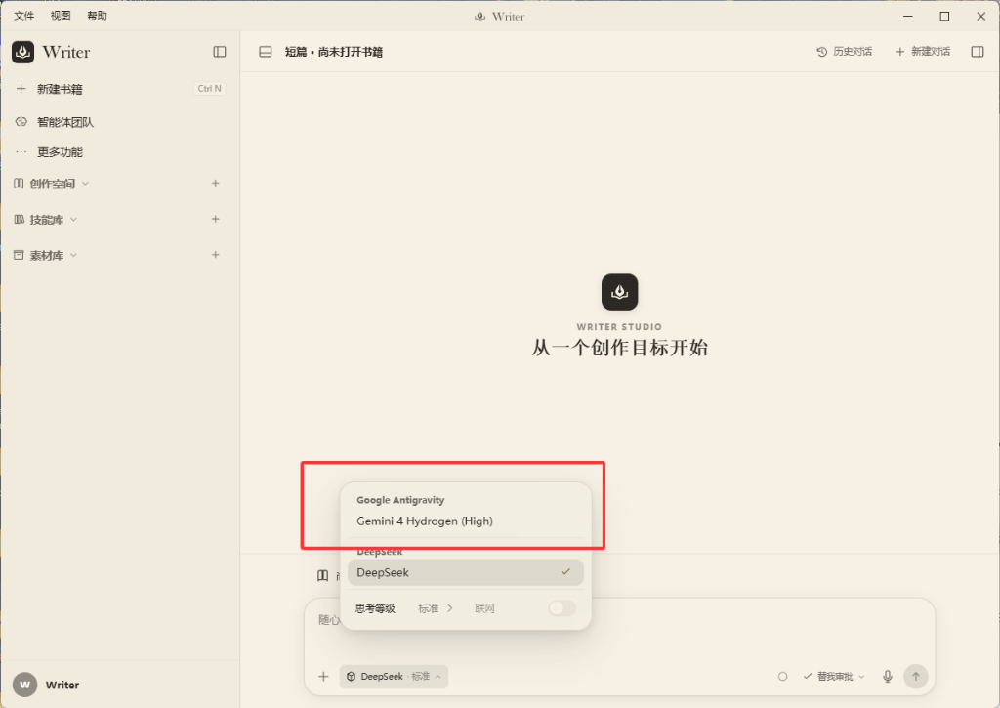
</p>

---

### 2. 五大创作空间 × 精细网文开书蓝图 × 五阶段长篇工作台
无论你写长篇连载、爆款短篇、影视剧本、学术论文还是剧本杀，都能在开书阶段获得贴合体裁的工程结构：

- **五大创作空间**：内置 **短篇、剧本、长篇、学术写作、剧本杀** 五套独立目录与工作流。
- **男频 / 女频精细赛道 + 三大平台节奏风向**：涵盖玄幻、仙侠、历史、都市高武、诡异悬疑、现代言情、宫斗宅斗、穿书等 60+ 细分题材，支持 **番茄快节奏**、**起点长线精品**、**晋江人设情感** 三大平台风向与热门流派标签组合。
- **实时题材开书蓝图**：选好赛道与标签后，自动生成包含开书定位、核心卖点、关键设定、黄金三章打法与七维世界观初始框架的开书蓝图，并可直接绑定已有**技能库**与**素材库**。
- **五阶段长篇工作台**：进入长篇后，围绕 **世界观 → 人物设计 → 剧情设计 → 正文 → 连续性账本** 五大阶段联动推进，随时切换当前创作目标与开书进度。

| 五大创作空间与女频题材分类 | 男频赛道、三大平台节奏与流派标签 |
| :---: | :---: |
| 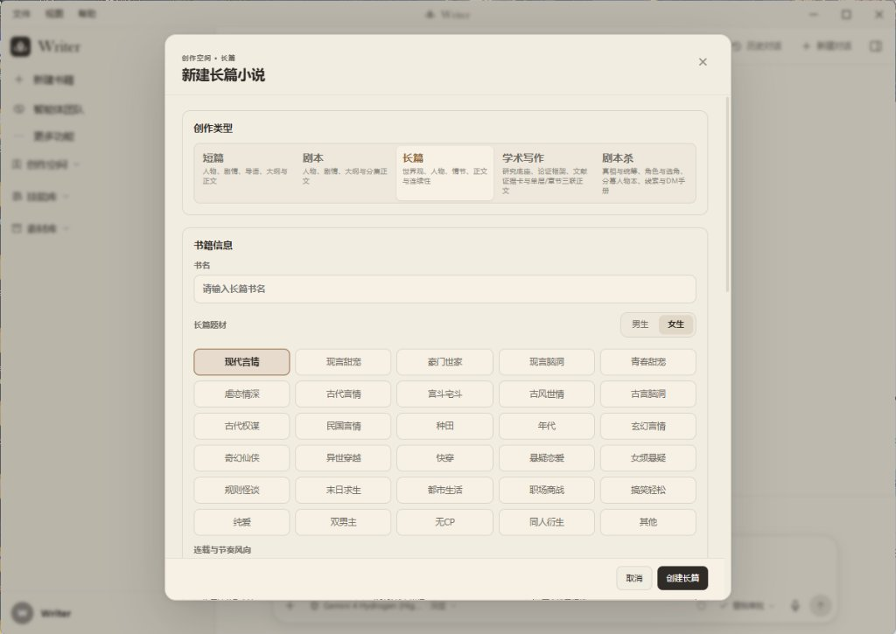 | 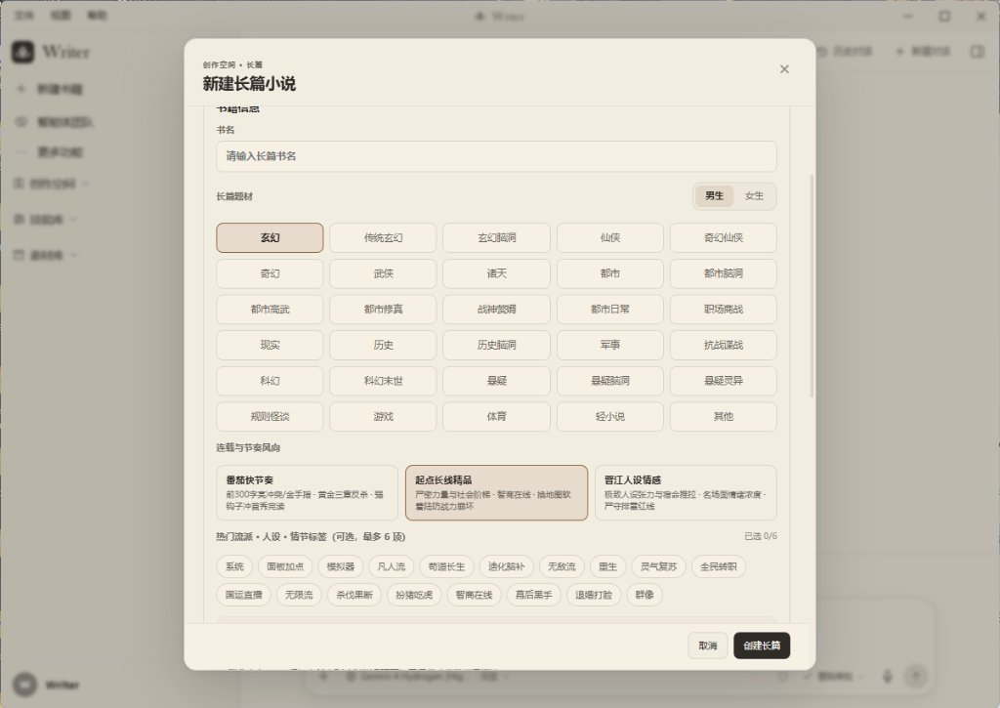 |
| **实时生成题材开书蓝图与资料库绑定** | **七维世界观目录与五阶段一键切换** |
| 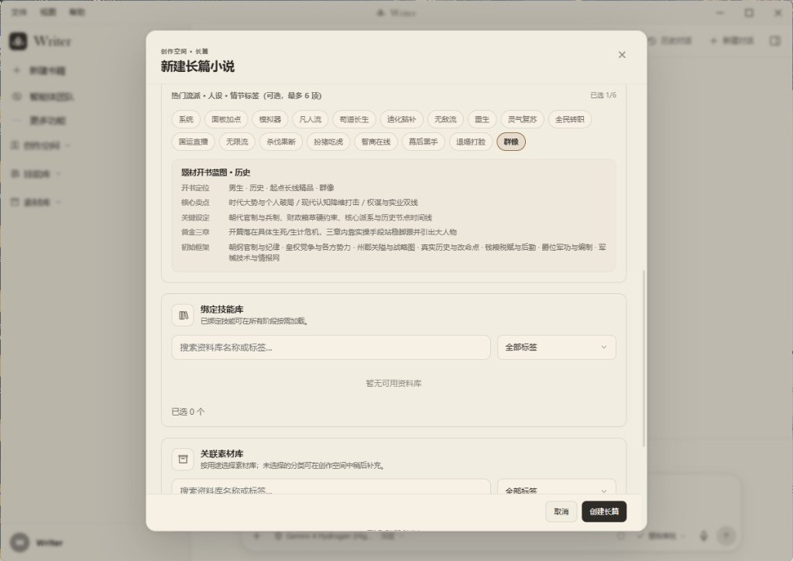 | 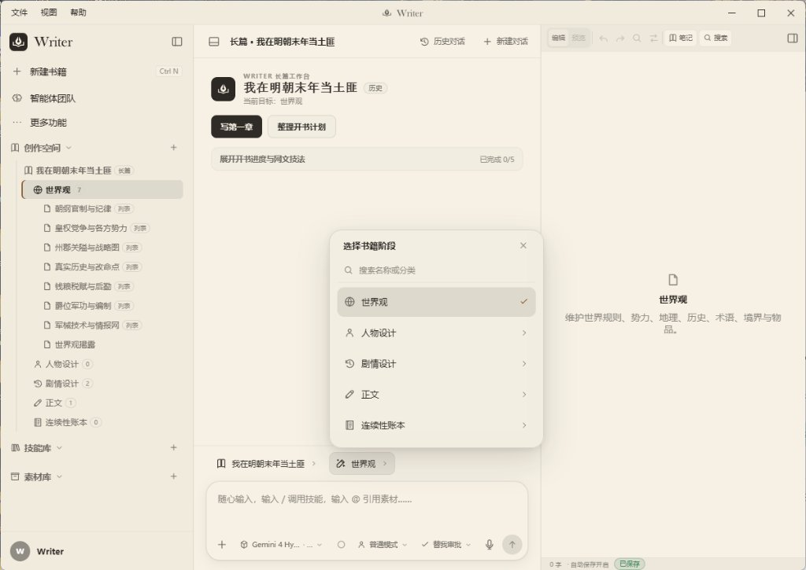 |

---

## 核心能力：为百万字连载而生的工程设计

<p align="center">
  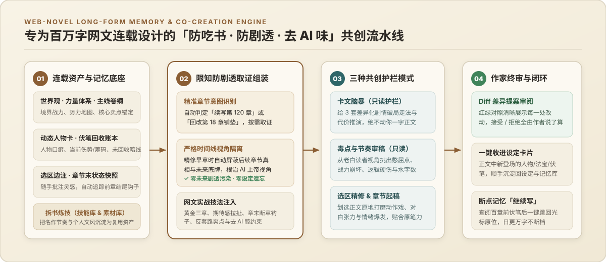
</p>

### 3. 百万字长篇记忆与「限知防剧透」取证引擎
普通 Agent 只会无脑塞入最近几轮聊天；Writer 内置了专门针对长篇小说的**章节连续性选择器与证据组装器（Continuity & Evidence Assembler）**：
- **动态追踪连载状态**：世界观设定、主线卷纲、人物卡、伏笔账本、章节边注与章末状态自动联动。
- **严格时间线视角裁剪**：当你站在第 80 章回改第 18 章的铺垫时，取证引擎会自动按第 18 章的时间线截断上下文，绝不把后续章节才揭晓的身份真相污染进早章正文。
- **原地查阅与一键「继续写」**：在正文里随时呼出全书检索或翻看百章前的人物设定、边注引用，看完一键跳回刚才停笔的精确光标位置，不断思路。

### 4. 懂网文行规的共创护栏（脑暴 / 审毒点 / 局部精修）
不想让 AI 乱动正文？在对话与选区工具条中，你可以按当下的真实创作意图切换护栏：
- **卡文脑暴（只读护栏）**：卡在剧情过渡或高潮转折时，让 Agent 结合既有伏笔推演多套破局走法与代价，只出点子，绝不碰正文一个字。
- **毒点与节奏审稿（只读护栏）**：站在老白读者与责编视角，挑出章节里的憋屈点、人设 OOC、战力崩坏、信息堆砌或断章无力。
- **选区原地试改 & 章节协作**：框选一段打斗、拉扯对白或情绪高潮，原地发起精修；正文中新写出的关键人物、道具或暗线，还能一键提炼收进设定卡片。

### 5. 拆书炼技闭环：把名作节奏变成你的专属「技能库」
- **长篇 / 短篇拆书分析**：支持分批拆解百万字级长篇或合集，深度提炼开篇黄金三章钩子、爽点兑现周期、人物弧光与叙事腔调。
- **改稿复盘 & 文风比对**：对比你自己的初稿与精修稿，让智能体总结你的个人修改习惯，自动沉淀为可复用的 Markdown **技能（Skill）** 与 **素材（Material）**。
- **`/` 调技能、`@` 引素材**：写作时在输入框随手输入 `/` 挂载黄金三章、断章钩子等技法，输入 `@` 精准喂入参考素材，随用随取。

### 6. 铁律级「Diff 提案审阅门」+ 0-Token 改稿数字守恒锁
- 智能体对任何文稿、大纲、设定的修改，**一律先生成红绿增删对照的 Diff 提案（Proposal）**，只有你点击接受后，Core 存储内核才会执行带版本锁的原子落盘。
- **局部改稿数字守恒锁与确定性正文门禁**：局部润色替换正文时，底层自动校验删减域中的时间点、百分比、银两/灵石/物资数量与复合时长，防止 AI 润色时顺手误删关键状态锚点；同时自动拦截跨段未闭合悬空引号与元话语泄密。

### 7. 6 角色专业长篇编剧室 × 连载平滑变轨 × 书页护眼美学
- **6 角色长篇智能体团队**：内置 `反套路章卡架构师`（多方案自动抽卡）、`他者盲演演员`（纯净无工具盲演沙盒防剧透）、`极净切片章节写手`、`只读总编审校官`、`连续性记录员`（`<=1,000` 字倒金字塔 Handoff 防截断）、`一致性审校`；支持协调者优先派活与阶段确认红线，每个成员均可独立指定模型。
- **连载中途平滑变轨**：写到几十万字想微调爽点节奏或叠加新流派时，不动已写前文一字，增量更新 `AGENTS.md` 并给出下章自然转轨建议。
- **为长时间码字调校的书页护眼美学**：浅色模式采用微黄书页护眼色（`#F6F1E4`），夜间模式采用阅读器级暖炭黑（`#1B1A18` + 暖灰字 `#C8C2B6`），支持独立调节 UI 字号与正文字号（宋体 / 楷体 / 仿宋 / 黑体 / 自定义字体导入）。

完整分步操作请查看 [**Writer 图文使用教程（docs/USER_GUIDE.md）**](./docs/USER_GUIDE.md)。

| 6 角色长篇专业编剧室 | 连载中途平滑变轨 | 夜间暖炭黑护眼工作台 |
| :---: | :---: | :---: |
| 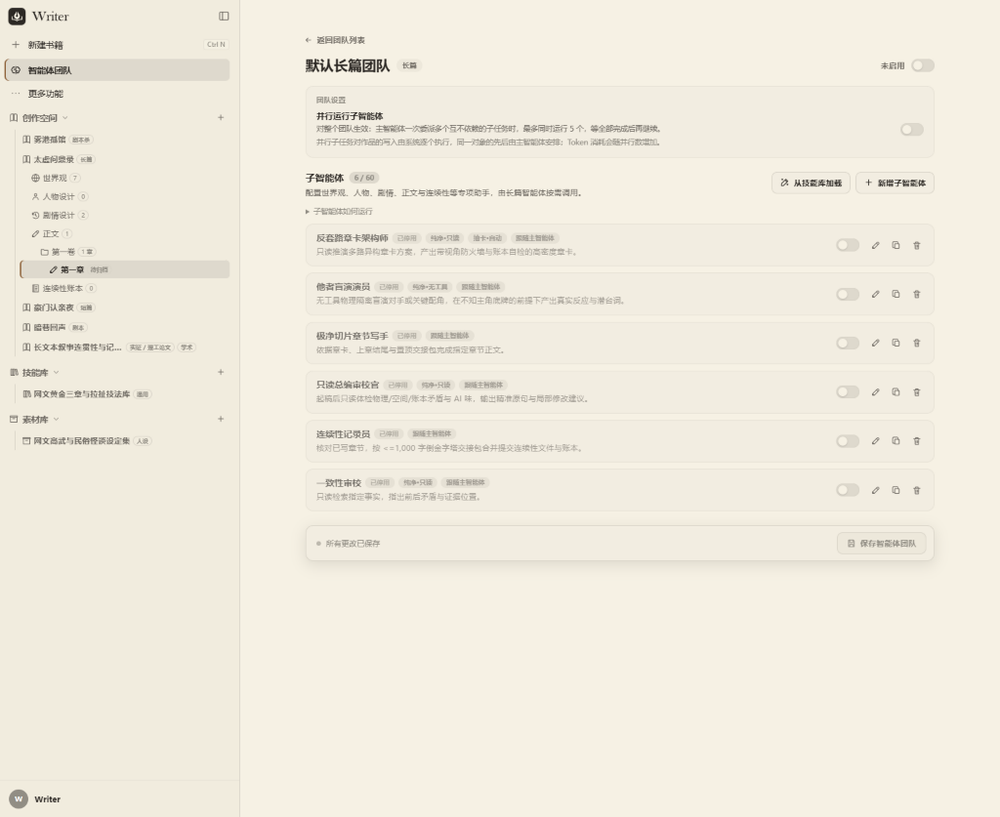 | 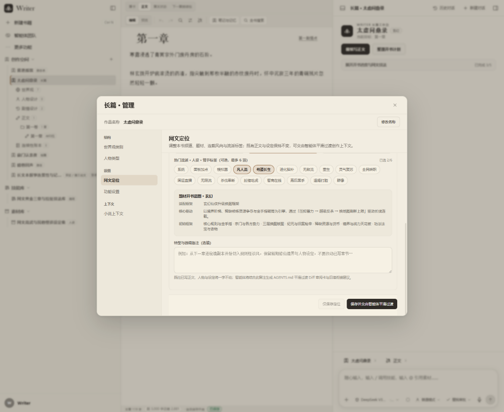 | 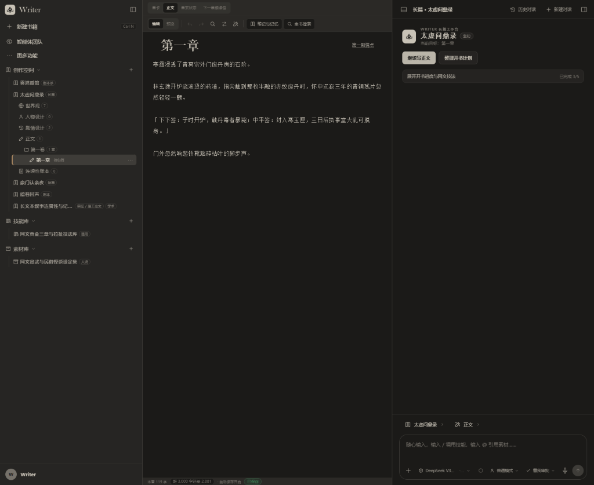 |

---

## 系统架构：五进程安全隔离 × DeepSeek Harness 内核

Writer 没有采用把数据库、密钥和模型请求一股脑塞进前端页面的粗糙做法，而是构建了工业级的 **Electron 五进程边界架构** 与 **DeepSeek Harness 智能体运行时内核**：

<p align="center">
  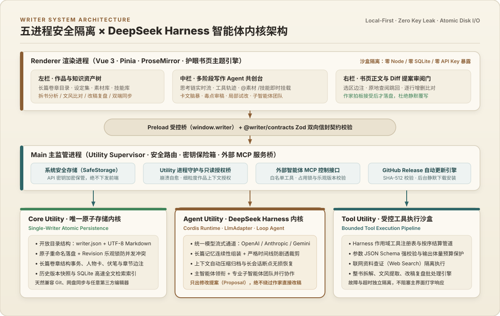
</p>

| 进程 / 模块 | 核心职责与工程边界 |
| --- | --- |
| **Renderer 渲染进程**<br>`apps/desktop/src/renderer` | Vue 3 + ProseMirror 工作台界面。严格通过编译期边界门禁（`lint:boundary`），**零 Node、零 Electron、零 SQLite、零 API Key / 订阅 Token 暴露**。 |
| **Preload 双向契约桥**<br>`packages/contracts` | 所有跨进程命令与流式事件全部经由 Zod Schema 双向强校验信封（Envelope）传输，杜绝非法载荷穿透。 |
| **Main 主监管进程**<br>`apps/desktop/src/main` | 负责窗口生命周期、操作系统级 `SafeStorage` 密钥与订阅凭证保险箱、多账号调度器、Utility 进程守护自愈、GitHub Release 自动更新以及外部 MCP 网关。 |
| **Core Utility 存储进程**<br>`apps/desktop/src/utilities` | **全系统唯一的磁盘写入者**。作品以开放的 `writer.json` + UTF-8 Markdown 文件夹存储，采用临时文件原子重命名 + Revision 乐观锁，配合 SQLite 全文索引，天然兼容 Git 与双端网盘同步。 |
| **Agent Utility 智能体进程**<br>`packages/agent-runtime` | 搭载 **DeepSeek Harness 内核**（Cordis 运行时 + `LlmAdapter` 统一流式通道 + 作用域工具注册管道 + 订阅故障切号流式引擎），驱动多轮写作 Loop Agent、6 角色编剧室与上下文自动压缩恢复。 |
| **Tool Utility 工具沙盒**<br>`apps/desktop/src/utilities` | 独立进程运行受控工具、联网检索与大体量拆书批处理，超时与异常完全隔离，绝不卡顿主界面码字帧率。 |

### 自带模型（BYOK）+ 订阅账号池 + 外部智能体协同（MCP）
- **自定义 API 与订阅模型无缝混用**：既支持通过 **订阅模型管理** 直连 9 大已订阅平台，也支持自定义接入 `OpenAI Completions`、`OpenAI Responses`、`Anthropic Messages`、`Google Generative AI` 等任意兼容接口（DeepSeek、Claude、GPT、Gemini、本地网关均可），并可按创作阶段或编剧室角色分别指定最擅长的模型与思考深度（Thinking Level）。
- **内置 MCP 外部控制协议**：开启外部智能体开关后，Claude Code、Codex、Cursor 等外部智能体可通过受控白名单安全读写作品上下文（内置占用锁与版本校验，绝不强行覆写正在编辑的章节）。

---

## 快速开始

### 方式一：下载安装包（开箱即用）

前往 [**GitHub Releases**](https://github.com/Minglink/Writer/releases/latest) 下载最新正式版安装包（当前版本 `v0.1.8`）：

| 平台 | 安装包文件 | 说明 |
| --- | --- | --- |
| **Windows 10 / 11 (x64)** | `Writer-0.1.8-win-x64.exe` | 下载后双击按向导安装，支持后续客户端内一键检测 GitHub Release 更新并后台升级 |

**首次打开三步开写：**
1. 选择你的本地作品存放目录（纯本地文件夹，随时可用资源管理器或 Git 查看）。
2. 打开左下角 `Writer → 设置`，在 **`订阅模型管理`** 中一键接入已有的 AI 订阅账号，或在 **`自定义模型`** 中填入 API 地址与密钥并点「测试连接」。
3. 点击左侧「`+ 新建书籍`」，选好创作空间、题材与节奏风向，开启你的新书连载！

### 方式二：从源码运行与构建

**环境要求：**
- Windows 10 / 11 (x64)
- `Node.js` >= 24.0.0
- `pnpm` >= 11.0.0

```bash
# 1. 克隆仓库
git clone https://github.com/Minglink/Writer.git
cd Writer

# 2. 安装依赖
pnpm install

# 3. 启动桌面开发环境（支持渲染层热更新）
pnpm dev
```

**常用工程与打包命令：**

```bash
pnpm build             # 构建生产产物并执行渲染包体量预算门禁
pnpm typecheck         # 全仓 Vue + TypeScript 跨包严格类型检查
pnpm lint              # ESLint 零警告 + 跨进程边界检查 + 多语言完整性检查
pnpm verify            # 全量格式、类型、边界、单测、磁盘集成测试与生产构建
pnpm pack:win          # 构建并冒烟校验 Windows x64 正式安装包 (apps/desktop/release/)
```

---

## 仓库目录导览

```text
Writer/
├── apps/
│   └── desktop/                 # Electron 桌面客户端
│       ├── src/main/            # 主进程：窗口、密钥保险箱、订阅账号管理与调度、安全 IPC、自动更新
│       ├── src/preload/         # Preload：window.writer 受控桥与双向契约校验
│       ├── src/utilities/       # Core 原子存储、Agent 运行入口、Tool 受控执行沙盒
│       ├── src/renderer/        # Vue 3 工作台、长篇共创界面、订阅模型管理、ProseMirror 编辑器
│       └── src/extras/          # 扩展智能体能力（长短篇拆书、改稿复盘、文风比对、双端同步、MCP）
├── packages/
│   ├── contracts/               # 跨进程命令、事件、订阅与领域模型的 Zod 契约单一事实源
│   ├── agent-runtime/           # 智能体运行时内核、DeepSeek Harness 接缝 (dsh/)、订阅流式切号与取证引擎
│   └── shared/                  # 无业务耦合的底层通用工具
├── tools/                       # 架构边界门禁、性能预算、多平台打包编排与发布校验脚本
└── docs/                        # 图文使用教程、设计文档与界面实拍截图
```

---

## 开源协议

本项目采用 **[PolyForm Noncommercial License 1.0.0](./LICENSE)** 非商业开源协议发布：

- **你可以自由地**：在个人创作、学习研究、学术交流与非商业场景下免费使用、阅读源码、修改定制和分享本项目。
- **未经授权禁止**：将本项目或其衍生版本用于任何商业售卖、付费 SaaS 托管服务或其他商业营利用途。

---

<div align="center">

**愿每一本用心构思的长篇，都不被琐碎的记忆负担与粗糙的工具辜负。**  
如果 **Writer** 对你的码字与创作有帮助，欢迎点亮右上角的 **Star** 支持项目持续迭代！

</div>
