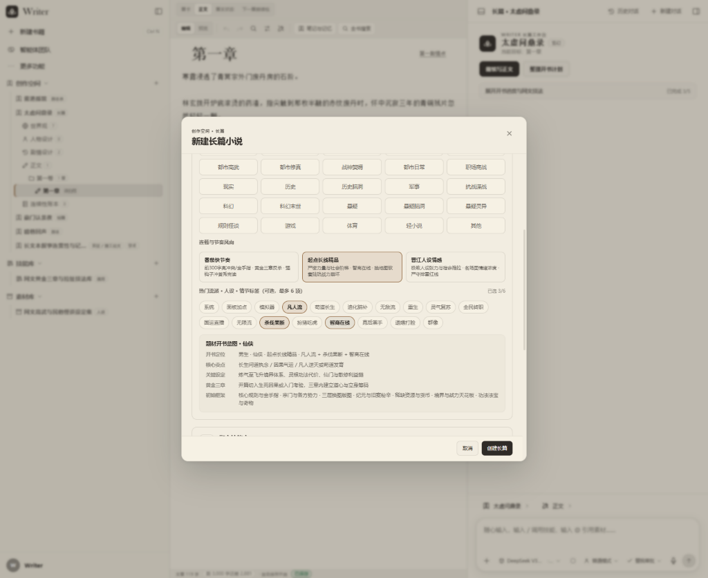
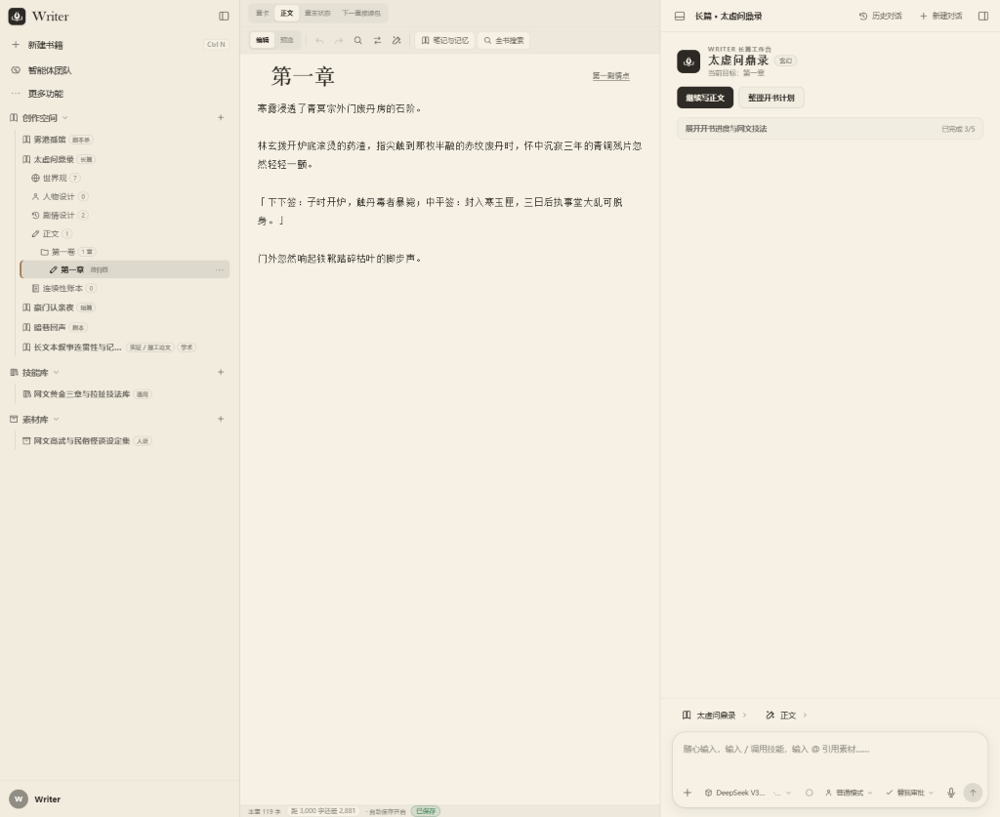
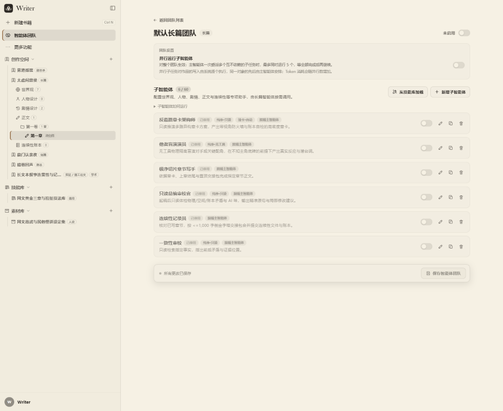
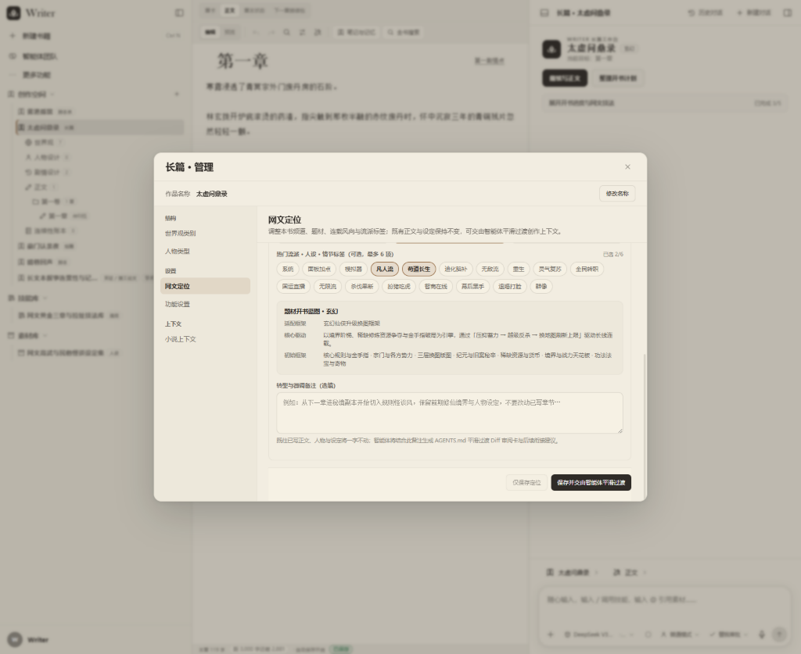
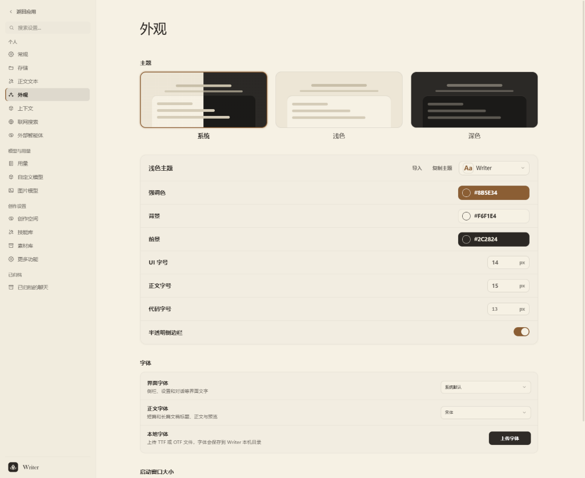
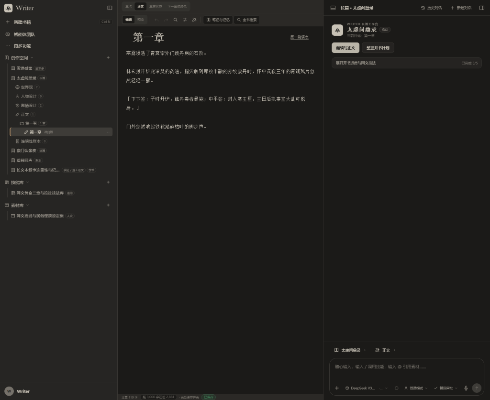

# Writer 图文使用教程

欢迎使用 **Writer** —— 专为网文作家与长篇创作者打造的本地优先 AI 写作 Agent 工作台。

本教程将带你从 **安装配置 → 开书定位 → 百万字长篇创作与防吃书 → 6 角色专业编剧室 → 连载平滑变轨 → 护眼与自定义外观**，一步步跑通完整写作流程。

---

## 目录

1. [下载安装与首次配置](#1-下载安装与首次配置)
2. [五分钟开书：题材分类、节奏风向与开书蓝图](#2-五分钟开书题材分类节奏风向与开书蓝图)
3. [三栏写作工作台：书页护眼、防剧透与改稿守恒锁](#3-三栏写作工作台书页护眼防剧透与改稿守恒锁)
4. [6 角色长篇专业编剧室（智能体团队）](#4-6-角色长篇专业编剧室智能体团队)
5. [连载中途平滑变轨与网文定位管理](#5-连载中途平滑变轨与网文定位管理)
6. [书页护眼主题、夜间模式与字体调节](#6-书页护眼主题夜间模式与字体调节)
7. [高频技巧与常见问题](#7-高频技巧与常见问题)

---

## 1. 下载安装与首次配置

1. 前往 [**GitHub Releases**](https://github.com/Minglink/Writer/releases/latest) 下载最新的 Windows x64 安装包（例如 `Writer-0.1.4-win-x64.exe`）并双击安装。
2. 首次启动时选择一个本地文件夹作为**作品根目录**：
   - 所有作品均以标准 `writer.json` + **UTF-8 Markdown** 文件夹保存在你自己的硬盘中，随时可用资源管理器、Git 或网盘同步备份。
3. 打开左下角 **设置 → 模型配置**，填写你常用的大模型 API 地址与密钥（支持 OpenAI Completions / Responses、Anthropic Messages、Google Generative AI 等兼容接口），点击「测试连接」通过后即可开写。
   - **安全说明**：API Key 由操作系统级 `SafeStorage` 加密保存在主进程中，渲染界面永远不接触明文密钥。

---

## 2. 五分钟开书：题材分类、节奏风向与开书蓝图

点击左侧边栏顶部的 **`+ 新建书籍`**，支持 **长篇、短篇、剧本、学术写作、剧本杀** 五大创作空间：

  

- **男频 / 女频精准分类**：覆盖玄幻、仙侠、都市高武、诡异悬疑、现言脑洞、宫斗宅斗、穿书读心等主流网文赛道，自动生成对应七维世界观框架。
- **连载与节奏风向（长篇） / 短篇节奏与篇幅风向（短篇）**：
  - 长篇可选 **番茄快节奏**（前 300 字亮冲突、黄金三章反杀）、**起点长线精品**（严密阶梯、换地图软着陆）、**晋江人设情感**（宿命推拉、情绪浓度与排雷红线）；
  - 短篇可选 **盐选/番茄爆款短篇** 或 **精品叙事短篇**。
- **热门流派与标签（最多 6 项）**：勾选核心卖点标签后，下方实时预览**开书蓝图**，并在建书时自动写入该书专属的 `AGENTS.md`（长篇上下文指南），开篇就能让 AI 懂你的赛道与写作红线。

---

## 3. 三栏写作工作台：书页护眼、防剧透与改稿守恒锁

进入作品后，界面采用可自由拖拽与一键折叠的三栏布局（**左侧目录树 · 中间正文/章卡/账本编辑区 · 右侧智能体共创对话**）：

  

### 核心工程护栏（零 Token 确定性保障）

1. **章卡 → 正文 → 章末状态 → 下一章接续包 全链路**：
   - 在章卡中写明 `视角：`、`禁止透露：`、`不能写破：`、`知情边界：`，取证引擎会自动激活**限知视角防火墙**，写早章或回改前文时绝不泄露后文底牌。
   - `下一章接续包（handoff）` 采用 `<=1,000` 字倒金字塔置顶结构（即时时空锚点、五维硬账本快照、跨章必圆隐患），彻底避免长程写作时关键伏笔被截断丢失。
2. **改稿数字守恒锁 + 正文硬门禁**：
   - 当智能体对小说正文执行局部润色替换时，底层**数字/时刻/量词守恒锁**会自动核对删改片段，防止 AI 顺手把 `22:35`、`500ml`、`50两银子`、冷却时间等关键状态锚点误删（中英文等价写法如 `22:35 == 二十二点三十五分` 自动放行，且豁免 `千钧一发`、`一步步`、`B1` 编号等误杀）。
   - 同时在写入前拦截跨段未闭合悬空引号与元话语泄密，确保每份 Diff 提案都干净可靠。
3. **Diff 提案审阅门**：
   - 智能体对文稿、章卡、`AGENTS.md` 的任何改动都会以红绿差异卡片呈现，点击「接受」才由 Core 内核带版本锁原子落盘；若你中途手动改过该段，系统会自动拦截冲突，绝不静默覆盖原稿。
4. **高效编辑器工具栏**：
   - 支持 **编辑 / 预览** 一键切换、**文档目录**、**查找替换**、**全书搜索（`Ctrl+Shift+F`）** 与 **笔记与记忆**（全部互斥弹出不重叠遮挡）；收起双侧栏进入纯沉浸码字时，工具栏左上角始终保留「展开左侧栏」入口。

---

## 4. 6 角色长篇专业编剧室（智能体团队）

点击左侧边栏 **智能体团队 → 默认长篇团队**，即可查看并按需定制 Writer 内置的 6 角色专业长篇编剧室：

  

| 编剧室角色 | 运行模式 | 核心职责 |
| --- | --- | --- |
| **反套路章卡架构师** (`plot_architect`) | `纯净 · 只读` + `抽卡 · 自动` | 自动并行推演多套反套路章卡走法供挑选，避免写进同质化套路 |
| **他者盲演演员** (`scene_actor`) | `纯净 · 无工具`（盲演沙盒） | 严格屏蔽全局底牌与秘密词，以角色当下真实认知推演对手戏与博弈反应 |
| **极净切片章节写手** (`chapter_writer`) | 标准执笔 | 依据审定章卡与限知证据包起稿正文，直出干净叙事 |
| **只读总编审校官** (`prose_auditor`) | `纯净 · 只读` | 审读毒点、AI 套话、节奏拖沓与人物 OOC，输出精准修改清单 |
| **连续性记录员** (`continuity_recorder`) | 账本归档 | 按 `<=1,000` 字倒金字塔结构沉淀章末状态、人物轨迹与下章接续包 |
| **一致性审校** (`continuity_reviewer`) | 终审校核 | 核对伏笔兑现、时间线、战力/资财账本与跨章隐患闭环 |

> 每个子智能体都可以独立指定最擅长的模型、思考深度与温度，或默认跟随主智能体模型；修改完成后点击底部「保存智能体团队」生效。

---

## 5. 连载中途平滑变轨与网文定位管理

写到几十万字想微调爽点节奏、叠加新流派，或调整读者频道？点击作品卡片旁的 **`管理 → 网文定位`**：

  

- **仅保存定位**：立即更新本书的题材、节奏风向与流派标签。
- **保存并交由智能体平滑过渡**：填写「转型与微调备注」后点击，系统会自动保留所有已写章节与既有设定**一字不改**，只把新定位增量合并进 `AGENTS.md`（经 Diff 审阅卡确认后落盘），并给出下一章自然转轨的过渡钩子建议。

---

## 6. 书页护眼主题、夜间模式与字体调节

打开左下角 **设置 → 外观**，可以自由切换浅色/深色主题、暖纸/护眼预设、强调色，以及独立调节 **界面字号（10–24px）** 与 **正文字号（10–40px）** 和中文字体：

  

切换为 **夜间模式（暖炭黑 `#1B1A18` + 暖灰正文字 `#C8C2B6`）** 后，深夜长时间爆更同样柔和不刺眼：

  

---

## 7. 高频技巧与常见问题

- **如何在对话里快速挂载技法与素材？**
  - 在右侧智能体输入框输入 `/` 挂载「技能库」里的黄金三章、竞品压迫感拆解、高能连章状态锁等技法；输入 `@` 精准引用「素材库」条目。
- **如何原地让 AI 精修某一段而不动整章？**
  - 在正文区选中目标段落，使用悬浮共创工具条发起「试改此处」，系统会强制走手动 Diff 审阅并激活数字守恒锁，只改选中片段。
- **如何在线升级到最新版本？**
  - 打开左下角 **设置 → 通用 → 检查更新**，即可一键检测 GitHub Release 最新版本并自动下载安装。
- **遇到问题或有建议？**
  - 欢迎在 [GitHub Issues](https://github.com/Minglink/Writer/issues) 反馈复现步骤或提交功能建议！
