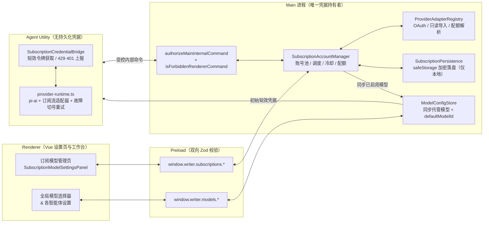
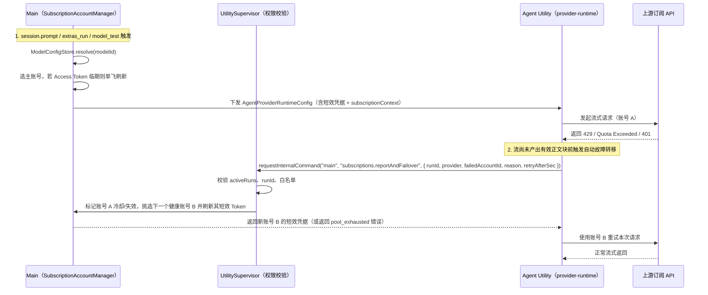

# 订阅模型管理（Subscription Model Management）架构设计稿

> 状态：已完成（Round 1–6 全部落地，一期至三期 9 平台全量接入）  
> 适用范围：Writer 桌面端（`packages/contracts`、`packages/agent-runtime`、`apps/desktop`）

## 1. 背景与目标

用户希望在 Writer 中直接导入并管理已订阅的 AI 平台账号（参考 `cockpit-tools` 的多平台账号管理体验），将其作为 Writer 的内置模型来源甚至全局默认 API 使用，而无需额外部署第三方代理软件。

核心目标：
1. **零外部依赖接入**：由 Writer Main 进程原生完成 OAuth / Device Flow 登录与 Token 刷新，并支持一键**只读**扫描导入本机已有的 CLI / IDE / Cockpit-Tools 凭证（绝不反向写回外部 IDE 的登录状态）。
2. **全家桶可扩展底座**：通过可插拔的 Provider Adapter 注册表，统一抽象认证方式、本地导入器、请求协议、模型目录与配额查询，覆盖 Google（Gemini CLI / Antigravity）、OpenAI Codex、GitHub Copilot、Claude、Kiro、Cursor、Windsurf、CodeBuddy。
3. **与 Writer 现有模型体系无缝融合**：采用「账号池与模型解耦」设计，将已授权平台的启用模型同步为 Writer 托管模型（`managedBy: "subscription"`），可直接设为全局默认模型（`defaultModelId`）或分配给任意创作空间、子智能体与扩展智能体。
4. **写作友好的多账号调度**：同平台多账号默认采用「**主账号优先 + 异常自动故障转移**」，最大程度保住长篇写作的上下文 Prompt Cache；遇到 `429` 限流、配额耗尽或 `401` 认证失效时自动切至池内下一个健康账号并重试，冷却期结束后自动恢复。
5. **安静统一的设置体验**：在 **设置 → 模型与用量** 下新增 **「订阅模型管理」** 独立页面，严格遵循 [DESIGN.md](../DESIGN.md) 与 [design/pages.md](../design/pages.md)，聚焦账号接入、套餐/配额监控、主号指定、单模型开关与一键设为默认。
6. **严守进程与安全边界**：Refresh Token 与会话凭证仅通过 Electron `safeStorage` 加密保存在本机 Main 进程，**不参与云端跨设备同步**，**永不进入 Renderer 或 Agent Utility 持久化**。

---

## 2. 总体架构与进程边界

严格遵守 [AGENTS.md](../AGENTS.md) 的进程隔离原则：Renderer 只读脱敏状态，所有凭据与账号池状态机驻留 Main，Agent Utility 通过受控的内部桥接按需获取短效凭据并上报故障。



### 2.1 运行时令牌刷新与中途中途切号时序

长篇写作一次 Agent Run 可能包含多轮工具调用（持续数分钟），若中途遇到 Access Token 过期（`401`）或账号限流（`429`），必须支持在 Run 内无感切换账号并继续，同时保证 Refresh Token 始终不出 Main：



**关键约束：**
- 仅在**本次模型调用尚未向用户流式输出正文/工具调用**时自动重试切号；若流已输出部分内容后中断，不上演重复拼接，直接记录账号状态并按现有错误处理链路返回明确提示，下次请求自然切到新账号。
- 内部命令 `subscriptions.acquireCredential` 与 `subscriptions.reportAndFailover` 必须加入 `apps/desktop/src/main/ipc/forbidden-commands.ts`，严禁 Renderer 调用。
- `apps/desktop/src/main/supervisor.ts` 扩展内部命令路由支持 `target: "main"`（当 `internalCommandHandle` 命中时直接由 Main 消费，不再查找 `this.workers.get(target)`），并在 `internal-command-authorizer.ts` 中绑定 `activeRuns` 校验（`model_test` 同样校验对应请求上下文）。

---

## 3. 平台适配矩阵与分期范围

所有平台统一通过 `SubscriptionProviderAdapter` 接口注册，互不耦合。非官方逆向协议（如部分 IDE 私有接口）在 UI 上明确标注「社区适配 / 非官方接口」提示，并在上游协议变更时优雅降级，不影响其他平台。

| 分期 | 平台 ID (`provider`) | 显示名称 | 登录 / 导入方式 | 运行时请求协议 (`ModelApi`) | 配额 / 套餐监控 | 渠道属性与备注 |
| --- | --- | --- | --- | --- | --- | --- |
| **一期** | `google-gemini-cli` | Google Gemini CLI | 浏览器 OAuth PKCE（loopback）+ 只读导入 `~/.gemini/oauth_creds.json` | `google-cloud-code-assist` | 支持（套餐级别 / 限流状态 / 重置时间） | 开源 CLI 协议，稳定度高 |
| **一期** | `google-antigravity` | Google Antigravity | 浏览器 OAuth（loopback）+ 只读导入本机 Antigravity / Cockpit-Tools 凭证 | `google-antigravity` | 支持（模型分组配额进度条 + 重置倒计时） | IDE 订阅渠道，支持 Gemini / Claude 等配额模型，标明非官方渠道提示 |
| **一期** | `openai-codex` | OpenAI Codex (ChatGPT) | 浏览器 OAuth PKCE（loopback `1455`/动态回退）+ 只读导入 `~/.codex/auth.json` | `openai-codex-responses`（复用 `pi-ai` 内置） | 支持（Plus / Pro / Team 等级 + 5h/周配额窗口） | 协议已被 `@earendil-works/pi-ai` 内置支持 |
| **一期** | `github-copilot` | GitHub Copilot | GitHub Device Flow（展示 8 位配对码 + 浏览器授权）+ 只读导入本机 Copilot Token | `github-copilot`（复用 `pi-ai` 内置模型与头） | 支持（Free / Pro / Pro+ / Business + 剩余高级请求配额） | 协议已被 `@earendil-works/pi-ai` 内置支持 |
| **二期** | `anthropic-claude` | Claude 订阅 (Pro / Max) | 浏览器 OAuth PKCE + 只读导入 `~/.claude/.credentials.json` | `anthropic-messages`（OAuth Bearer 模式） | 支持（套餐与限流窗口恢复时间） | 复用现有 `anthropic-messages` 流，增加 OAuth 头适配 |
| **二期** | `kiro` | Kiro (AWS) | AWS Builder ID Device Flow / Social OAuth + 只读导入本机 Kiro 凭证 | `kiro-codewhisperer` | 支持（免费/付费额度余额与重置日期） | 独立协议适配器 |
| **三期** | `cursor` | Cursor | 本机只读导入（Cursor SQLite 状态库 / 手动导入 Token） | `cursor-connect`（Connect / Protobuf 流） | 支持（Fast/Premium 额度与套餐） | 私有协议，高变更风险，标明非官方渠道提示 |
| **三期** | `windsurf` | Windsurf | 本机只读导入（Windsurf 本地配置 / Token） | `windsurf-connect` | 支持（Prompt / Flow Credits 余额） | 私有协议，标明非官方渠道提示 |
| **三期** | `codebuddy` | CodeBuddy | OAuth / 本机只读导入 | `codebuddy-chat` | 支持（配额与到期时间） | 独立协议适配器 |

> 注：所有本地导入器严格遵守**只读原则**（仅 `readFile` / 只读模式打开 SQLite），绝不修改外部 IDE/CLI 的配置文件、数据库或进程状态。

---

## 4. 契约与数据模型设计（`packages/contracts`）

新增目录 `packages/contracts/src/subscriptions/`，并在 `packages/contracts/src/index.ts` 与 `packages/contracts/src/renderer.ts` 按边界导出（Renderer 仅导入类型与 UI 所需的轻量常量/Schema）。

### 4.1 扩展现有模型契约（`packages/contracts/src/model-configuration.ts`）

1. 扩展托管来源枚举：
   ```ts
   export const ModelManagedBySchema = z.enum(["writer-free", "subscription"]);
   ```
   > 好处：`model-config-sync.ts` 中 `if (!model || model.managedBy) return null;` 与 `model-config-state.ts` 中的自定义模型过滤会自动将订阅模型排除在云端同步与自定义模型上限之外，零侵入且保持旧数据向后兼容（遵守 [error/schema-compat.md](../error/schema-compat.md)）。

2. 扩展 `ModelApiSchema`（已完成全部分期协议标识）：
   ```ts
   export const ModelApiSchema = z.enum([
     "openai-completions",
     "openai-responses",
     "openai-codex-responses",
     "github-copilot",
     "anthropic-messages",
     "google-generative-ai",
     "google-cloud-code-assist",
     "google-antigravity",
     "kiro-codewhisperer",
     "cursor-connect",
     "windsurf-connect",
     "codebuddy-chat"
   ]);
   ```

3. 订阅托管模型 ID 规范：
   - 格式：`sub:<provider>:<modelSlug>`（总长 ≤ 120，如 `sub:google-gemini-cli:gemini-2.5-pro`、`sub:openai-codex:gpt-5.3-codex`）。
   - 提供工具函数 `SUBSCRIPTION_MODEL_ID_PREFIX = "sub:"` 与 `isSubscriptionModel(model)`。

4. 运行时配置扩展（仅内部 `AgentProviderRuntimeConfigSchema`，不暴露给 Renderer 持久化）：
   ```ts
   export const SubscriptionRuntimeAuthSchema = z.object({
     provider: SubscriptionProviderIdSchema,
     accountId: z.string().min(1).max(120),
     expiresAt: z.string().datetime().optional(),
     extraHeaders: z.record(z.string(), z.string()).optional(),
     metadata: z.record(z.string(), z.string()).optional() // 例如 projectId / endpointVariant
   });
   ```
   在 `AgentProviderRuntimeConfigSchema` 上挂载可选字段 `subscriptionAuth: SubscriptionRuntimeAuthSchema.optional()`，短效 Access Token 仍复用 `apiKey` 字段传入运行时流（或由协议适配器读取 `apiKey` + `subscriptionAuth`）。

### 4.2 订阅领域 Schema（`packages/contracts/src/subscriptions/`）

```ts
export const SubscriptionProviderIdSchema = z.enum([
  "google-gemini-cli",
  "google-antigravity",
  "openai-codex",
  "github-copilot",
  "anthropic-claude",
  "kiro",
  "cursor",
  "windsurf",
  "codebuddy"
]);

export const SubscriptionAccountStatusSchema = z.enum([
  "active",          // 健康可用
  "cooldown",        // 429 或临时限流冷却中
  "quota_exhausted", // 配额耗尽，等待重置
  "expired",         // Token 失效，需重新登录/导入
  "disabled"         // 用户手动停用
]);

export const SubscriptionQuotaBucketSchema = z.object({
  id: z.string().min(1).max(80),
  label: z.string().min(1).max(120),       // 如 "Pro 配额" / "5h 窗口" / "高级请求"
  remainingPercent: z.number().min(0).max(100).optional(),
  used: z.number().nonnegative().optional(),
  limit: z.number().positive().optional(),
  unit: z.string().max(32).optional(),     // 如 "requests" / "credits"
  resetsAt: z.string().datetime().optional()
});

export const SubscriptionAccountSummarySchema = z.object({
  id: z.string().min(1).max(120),
  provider: SubscriptionProviderIdSchema,
  displayName: z.string().min(1).max(160), // 邮箱或用户名（已脱敏/无敏感 token）
  email: z.string().max(240).optional(),
  planTier: z.string().max(80).optional(), // 如 "Pro" / "Ultra" / "Plus" / "Free"
  source: z.enum(["oauth", "device_flow", "local_import", "manual_token"]),
  isPrimary: z.boolean(),
  enabled: z.boolean(),
  status: SubscriptionAccountStatusSchema,
  statusMessage: z.string().max(300).optional(),
  cooldownUntil: z.string().datetime().optional(),
  quotaUpdatedAt: z.string().datetime().optional(),
  quotaBuckets: z.array(SubscriptionQuotaBucketSchema).max(20),
  createdAt: z.string().datetime(),
  lastUsedAt: z.string().datetime().optional()
});

export const SubscriptionModelItemSchema = z.object({
  id: z.string().min(1).max(120),          // sub:<provider>:<slug>
  provider: SubscriptionProviderIdSchema,
  modelId: z.string().min(1).max(240),
  label: z.string().min(1).max(120),
  description: z.string().max(500).optional(),
  api: ModelApiSchema,
  reasoning: z.boolean(),
  defaultThinkingLevel: ThinkingLevelSchema,
  contextWindow: ModelContextWindowSchema.optional(),
  maxTokens: ModelMaxTokensSchema.optional(),
  enabled: z.boolean(),                    // 控制是否同步到 Writer 全局模型列表
  recommended: z.boolean().optional()      // 是否属于该平台默认开启的主力模型
});

export const SubscriptionProviderOverviewSchema = z.object({
  provider: SubscriptionProviderIdSchema,
  name: z.string().min(1).max(80),
  description: z.string().max(300),
  phase: z.union([z.literal(1), z.literal(2), z.literal(3)]),
  implemented: z.boolean(),                // 未实现分期可在列表置灰/折叠或按配置隐藏
  unofficialWarning: z.string().max(300).optional(),
  supportedAuthMethods: z.array(
    z.enum(["oauth", "device_flow", "local_import", "manual_token"])
  ),
  accounts: z.array(SubscriptionAccountSummarySchema).max(50),
  models: z.array(SubscriptionModelItemSchema).max(100)
});

export const SubscriptionSettingsSnapshotSchema = z.object({
  providers: z.array(SubscriptionProviderOverviewSchema).max(20),
  defaultModelId: z.string().max(120)
});
```

### 4.3 IPC 命令与事件清单

所有跨进程调用走 `CommandEnvelope`；Preload 暴露为 `window.writer.subscriptions.*`：

| 命令类型 | 调用方 | 职责 |
| --- | --- | --- |
| `subscriptions.getState` | Renderer | 获取所有平台的脱敏账号列表、配额快照、模型列表与当前 `defaultModelId` |
| `subscriptions.startAuth` | Renderer | 启动浏览器 OAuth 或 Device Flow；返回 `authSessionId`（Device Flow 同时返回 `userCode` 与 `verificationUri`） |
| `subscriptions.cancelAuth` | Renderer | 取消进行中的 OAuth / Device Flow 授权会话 |
| `subscriptions.scanLocal` | Renderer | 只读扫描本机指定平台（或全部已实现平台）的可导入凭证候选列表（仅返回来源路径描述与账号标识，不含 Token） |
| `subscriptions.importLocal` | Renderer | 将选中的本机凭证导入到 Writer 本地加密存储（若同邮箱已存在则更新凭证） |
| `subscriptions.importManual` | Renderer | 手动粘贴导入 Cursor / Windsurf 访问令牌、会话凭证或 JSON（经 Main 加密存储，返回脱敏快照） |
| `subscriptions.setPrimaryAccount` | Renderer | 指定某平台的主账号 |
| `subscriptions.setAccountEnabled` | Renderer | 启用或停用单个账号 |
| `subscriptions.removeAccount` | Renderer | 删除账号及其加密凭证 |
| `subscriptions.refreshQuota` | Renderer | 手动刷新单个账号或某平台全部账号的套餐与配额 |
| `subscriptions.setModelEnabled` | Renderer | 开关某个订阅模型，并同步刷新 `ModelConfigStore` |
| `subscriptions.setDefaultModel` | Renderer | 将指定订阅模型设为全局 `defaultModelId`（若模型未启用则同时启用） |
| `subscriptions.acquireCredential` | **仅 Agent（禁止 Renderer）** | 为当前 Run 获取最新有效短效凭据 |
| `subscriptions.reportAndFailover` | **仅 Agent（禁止 Renderer）** | 上报 `429`/`401`/配额耗尽，标记原账号状态并尝试切换下一个健康账号 |

实时推送事件（Main → Renderer，复用桌面事件通道）：
- `subscriptions.authProgress`：通知 OAuth / Device Flow 状态（`pending` / `completed` / `failed` / `cancelled`）
- `subscriptions.stateChanged`：当后台故障转移、冷却到期、配额刷新或自动设为默认模型发生变化时，主动通知 Renderer 刷新视图（无需整页刷新，避免闪烁）

---

## 5. Main 进程模块设计（`apps/desktop/src/main/subscriptions/`）

建议目录划分，严格按单一职责拆分，避免单文件过大：

```text
apps/desktop/src/main/subscriptions/
├── types.ts                      # SubscriptionProviderAdapter 接口、凭据内部类型（仅 Main）
├── registry.ts                   # ProviderAdapterRegistry 注册表
├── persistence.ts                # config/subscription-accounts.json 原子读写 + safeStorage 加密
├── scheduler.ts                  # 账号池选号、冷却计时、429/401 故障转移状态机
├── token-refresh-lock.ts         # 按 accountId 单飞刷新锁（避免并发请求重复刷新同一 Refresh Token）
├── oauth-loopback.ts             # 本地临时 loopback HTTP 服务器（PKCE + state 校验 + 超时清理）
├── manager.ts                    # SubscriptionAccountManager（对外协调入口 + 对接 ModelConfigStore）
├── ipc-commands.ts               # handleSubscriptionCommands（Main IPC 路由）
└── providers/
    ├── google-gemini-cli.ts      # 一期：Google OAuth + ~/.gemini 只读导入 + Cloud Code Assist 目录/配额
    ├── google-antigravity.ts     # 一期：Google OAuth + 本机 Antigravity/Cockpit-Tools 只读导入 + 配额
    ├── openai-codex.ts           # 一期：OpenAI OAuth PKCE + ~/.codex/auth.json 只读导入 + 配额
    ├── github-copilot.ts         # 一期：GitHub Device Flow + Copilot Token 换取 + 本机只读导入 + 配额
    ├── anthropic-claude.ts       # 二期
    ├── kiro.ts                   # 二期
    ├── cursor.ts                 # 三期
    ├── windsurf.ts               # 三期
    └── codebuddy.ts              # 三期
```

### 5.1 Provider Adapter 统一接口（`types.ts`）

```ts
export interface StoredAccountSecret {
  accessToken: string;
  refreshToken?: string;
  idToken?: string;
  expiresAt?: string;            // ISO 8601
  providerToken?: string;        // 如 Copilot 换取的短效 API token
  providerTokenExpiresAt?: string;
  extra?: Record<string, string>; // 如 projectId / tenant / accountTag
}

export interface SubscriptionProviderAdapter {
  readonly id: SubscriptionProviderId;
  readonly meta: {
    name: string;
    description: string;
    phase: 1 | 2 | 3;
    unofficialWarning?: string;
    supportedAuthMethods: readonly SubscriptionAuthMethod[];
  };

  /** 发起原生授权（浏览器 OAuth 或 Device Flow） */
  startAuth?(ctx: AuthFlowContext): Promise<AuthFlowHandle>;

  /** 只读扫描本机可导入凭证（绝不写入外部文件） */
  scanLocalCandidates?(): Promise<LocalCredentialCandidate[]>;

  /** 执行本地凭证读取并规范化为账号 + 秘密 */
  importLocalCandidate?(candidateId: string): Promise<ImportedAccountResult>;

  /** 刷新 Access Token / 派生短效 API Token */
  refreshSecret(
    account: StoredAccountRecord,
    secret: StoredAccountSecret,
    signal?: AbortSignal
  ): Promise<StoredAccountSecret>;

  /** 查询账号订阅等级与剩余配额 */
  fetchQuota(
    account: StoredAccountRecord,
    secret: StoredAccountSecret,
    signal?: AbortSignal
  ): Promise<QuotaFetchResult>;

  /** 返回该平台支持的模型清单（静态内置基线 + 可选远程动态拉取） */
  listModels(
    account?: StoredAccountRecord,
    secret?: StoredAccountSecret,
    signal?: AbortSignal
  ): Promise<SubscriptionModelDefinition[]>;

  /** 构造传给 Agent Utility 的短效运行时凭据（禁止包含 refreshToken） */
  toRuntimeCredential(
    account: StoredAccountRecord,
    secret: StoredAccountSecret,
    model: SubscriptionModelDefinition
  ): ResolvedSubscriptionCredential;
}
```

### 5.2 本地安全持久化（`persistence.ts`）

- 文件路径：`<userData>/config/subscription-accounts.json`（与 `models.json` 同级，独立文件，不污染原模型配置版本，也不参与 `device-sync`）。
- 写入模式：复用 `withConfigurationLock` + 临时文件写入 + `fsync` + 原子 `rename`，保证崩溃不损坏。
- 加密策略：
  - 每个账号的 `StoredAccountSecret` JSON 经 `safeStorage.encryptString(...).toString("base64")` 加密后存入 `encryptedSecrets[accountId]`。
  - 若 `safeStorage.isEncryptionAvailable()` 为 `false`，明确拒绝明文落盘并给出友好中文提示（与 `model-config-state.ts` 保持一致）。
  - 所有错误消息、日志与异常详情严禁包含 Token、Authorization 头或完整凭证 JSON。

### 5.3 账号池调度与故障转移规则（`scheduler.ts`）

每个平台独立维护一个账号池：
1. **选号优先级**：
   - 优先选择 `enabled && isPrimary && status === "active"` 的主账号（最大化 Prompt Cache 命中）。
   - 若主账号处于 `cooldown` 但 `cooldownUntil <= now`，先自动恢复为 `active` 并优先使用。
   - 若主账号不可用（仍在冷却 / 配额耗尽 / 已失效 / 已停用），按池内顺序选择第一个 `enabled && status === "active"` 的备用账号。
   - 若全部启用账号均不可用，返回结构化错误码 `subscriptions.pool_exhausted`，消息中明确提示最近一个可恢复的冷却/重置时间或引导重新授权。
2. **冷却与恢复策略**：
   - `429 Too Many Requests`：若响应头含 `Retry-After` / 上游返回 `resetAt`，按其设定 `cooldownUntil`（设上限保护）；否则采用指数退避（30s → 2m → 5m → 15m），标记为 `cooldown`。
   - 明确配额耗尽（Quota Exceeded / Daily Limit）：标记为 `quota_exhausted`，以配额重置时间作为 `cooldownUntil`（无重置时间则默认 30 分钟后允许重新探测）。
   - `401 / 403 Unauthorized`：先尝试执行一次单飞 `refreshSecret`；若刷新仍失败，标记账号为 `expired` 并立即切号，同时通过 `subscriptions.stateChanged` 提醒用户重新登录。
3. **与 `ModelConfigStore` 的同步机制**：
   - `ModelConfigStore` 注入 `SubscriptionCatalogReader`（与现有的 `FreeModelCatalogReader` 对称）。
   - **仅将已启用且所属平台至少有 1 个已启用账号的订阅模型**投影进入 `ModelConfigStore.models`（`managedBy: "subscription"`、`hasApiKey: true`），避免未启用的几十个订阅模型塞满 `models` 数组或触及 100 条模型上限。
   - **首次接入自动设为默认**：当某平台成功导入/登录第一个账号、同步出主力订阅模型后，若当前 `defaultModelId` 为空或指向不可用项且用户尚未配置任何带有效 Key 的自定义模型，自动将主力订阅模型设为 `defaultModelId` 并发出 toast/事件提示。
   - 当某平台所有账号被删除或全部停用时，自动从 `models` 移除该平台的托管模型；若当前 `defaultModelId` 正好属于该平台，按 `synchronizeSettings` 现有回退规则回落到其他可用文本模型。

---

## 6. Agent Runtime 改造设计（`packages/agent-runtime`）

### 6.1 协议流适配（`packages/agent-runtime/src/provider-runtime.ts`）

1. **复用 `@earendil-works/pi-ai` 内置协议（一期直接复用）**：
   - `openai-codex-responses`：引入 `@earendil-works/pi-ai/api/openai-codex-responses.lazy`，透传短效 OAuth Access Token 与 Codex 必需头（如 `chatgpt-account-id` 存于 `subscriptionAuth.extraHeaders`）。
   - `github-copilot`：引入 `@earendil-works/pi-ai/api/github-copilot-headers` 及对应 `openai-completions` / `openai-responses` / `anthropic-messages` 路由，传入 Main 换取好的 Copilot 短效 API Token 与 IDE 兼容头。
2. **新增 Google 订阅协议流（一期实现，独立文件放在 `packages/agent-runtime/src/subscriptions/`）**：
   - `google-cloud-code-assist.ts`：实现 Gemini CLI 使用的 Cloud Code Assist `streamGenerateContent` SSE 协议，复用 `pi-ai` 的 `google-shared` 消息/工具转换与现有 `applyGeminiWritingSafetySettings`，输出标准 `AssistantMessageEventStream`。
   - `google-antigravity.ts`：实现 Antigravity 订阅端点流式封装与思考签名/工具调用兼容，同样输出标准 `AssistantMessageEventStream`。
3. **二期 / 三期协议扩展**：
   - 二期：`anthropic-messages` 增加 OAuth Bearer 鉴权分支（而非 `x-api-key`）；新增 `kiro-codewhisperer.ts`。
   - 三期：新增 `cursor-connect.ts`、`windsurf-connect.ts`、`codebuddy-chat.ts`。

### 6.2 统一故障转移重试包装器（`packages/agent-runtime/src/subscriptions/failover-stream.ts`）

- 包装 `provider-runtime.ts` 返回的 `streamFn`（类似现有的 `withDeveloperRoleFallback`）。
- 当 `config.subscriptionAuth` 存在且注入了 `SubscriptionCredentialBridge` 时：
  1. 若当前持有的短效 Token 距 `expiresAt` 不足 60 秒，先向 Main 请求 `subscriptions.acquireCredential` 刷新。
  2. 监听上游事件流：若在产出首个文本/思考/工具调用事件前捕获到可切换错误（`429`、配额耗尽、`401`/`403`），调用 `bridge.reportAndFailover(...)`。
  3. Main 返回新账号的短效凭据后，最多在池内重试 `min(poolSize, 3)` 次；若全部耗尽或发生非账号类错误（如请求体过大、网络断开），立即返回清晰中文错误，不无限重试。
- `models.test`（连接测试）同样经过该协议层，确保用户在「订阅模型管理」里点“测试连接”能真实验证当前账号与协议。

---

## 7. 界面与交互设计（「订阅模型管理」）

严格遵循 [DESIGN.md](../DESIGN.md)、[design/pages.md](../design/pages.md)、[design/forms.md](../design/forms.md) 与 [design/feedback.md](../design/feedback.md)。

### 7.1 入口与代码分割

- 位置：**设置 → 模型与用量 (`models-and-usage`) → 订阅模型管理 (`subscription-models`)**，排在「自定义模型设置」下方或上方（建议顺序：用量 → 订阅模型管理 → 自定义模型设置 → 图像模型设置）。
- **按需加载与体积预算保护**（遵守 [error/budget-exceeded.md](../error/budget-exceeded.md)）：
  - 在 `SettingsPage.vue` 中通过 `defineAsyncComponent` 懒加载 `SubscriptionModelSettingsPanel.vue`，绝不打入启动主包，也不给 `WorkspaceShell.vue` 增加业务代码。
  - 文案保持精简克制，优先按需加载或控制在 i18n 语言包预算内，不私自调高 `tools/check-renderer-build.mjs` 预算。
  - 所有组件样式放入独立 CSS 文件或 `<style scoped>`，所有自定义类名加 `sub-model-` 前缀，避免全局类名冲突（遵守 [error/css-class-collision.md](../error/css-class-collision.md)）。

### 7.2 页面布局与视觉结构

沿用设置页标准 760px 分组宽度、圆角卡片（`--surface-raised` + `--theme-line-soft`）与克制的中性色层级，不做大面积彩色渐变或仪表盘式花哨装饰：

```text
订阅模型管理
导入并管理已订阅的 AI 账号，作为 Writer 的内置模型与默认 API。凭证仅加密保存在本机，不同步至云端。
                                                      [扫描本机凭证]  [刷新配额]

┌─ 平台切换分段 / 平台列表（Google Gemini CLI · Antigravity · OpenAI Codex · GitHub Copilot · ...）─┐
│  [Google Gemini CLI (2)]  [Antigravity (1)]  [OpenAI Codex (1)]  [GitHub Copilot]  ...          │
└─────────────────────────────────────────────────────────────────────────────────────────────────┘

（若为非官方 IDE 适配渠道，展示一行克制的弱底提示条 --surface-muted）
ℹ 当前平台通过社区适配协议接入，仅在本机只读使用凭证；如上游接口调整可能导致短暂不可用。

账号池                                                      [+ OAuth 登录]  [导入本机]
┌─────────────────────────────────────────────────────────────────────────────────────────────────┐
│ ● user1@example.test   [Pro] [主账号] [可用]                       [刷新] [测试] [停用] [移除]  │
│   配额：Gemini 2.5 Pro  ████████░░ 82% · 3 小时后重置                                            │
├─────────────────────────────────────────────────────────────────────────────────────────────────┤
│ ○ user2@example.test   [Pro] [冷却中 · 2m 后恢复]         [设为主账号] [刷新] [停用] [移除]      │
│   配额：Gemini 2.5 Pro  ██░░░░░░░░ 18% · 45 分钟后重置                                           │
└─────────────────────────────────────────────────────────────────────────────────────────────────┘

可用模型（已启用的模型将出现在 Writer 全局模型选择器中）
┌─────────────────────────────────────────────────────────────────────────────────────────────────┐
│ Gemini 2.5 Pro   [当前默认]                                                  [测试]   [开关 ON]  │
│ sub:google-gemini-cli:gemini-2.5-pro · 1M 上下文 · 支持深度思考                                   │
├─────────────────────────────────────────────────────────────────────────────────────────────────┤
│ Gemini 2.5 Flash                                                   [设为默认] [测试]  [开关 ON]  │
│ sub:google-gemini-cli:gemini-2.5-flash · 1M 上下文                                               │
└─────────────────────────────────────────────────────────────────────────────────────────────────┘
```

### 7.3 关键交互细节

- **防闪烁与乐观更新**（遵守 [error/ui-flicker.md](../error/ui-flicker.md)）：
  - 切换单模型开关、设为主账号、设为默认模型时采用局部 loading / 乐观更新，不把整个设置页变灰或重新挂载列表。
  - 删除账号使用标准居中模态确认框（`design/dialogs.md`），主操作用危险红色按钮。
- **Device Flow 授权弹窗**（如 GitHub Copilot / Kiro）：
  - 居中模态弹窗展示大号等宽配对码 +「复制并打开浏览器」主按钮 + 后台轮询状态指示 +「取消」按钮，授权成功后自动关闭弹窗并刷新该平台账号池。
- **本机只读扫描弹窗**：
  - 点击「扫描本机凭证」或平台卡片内「导入本机」后，展示扫描到的本地账号列表（平台、账号名、来源类型如 `Gemini CLI 本地配置` / `Codex CLI`），用户勾选后一键导入；扫描不到时给出简短说明引导使用原生登录。
- **紧凑窗口与大字号兼容**：
  - 所有行项使用 `min-width: 0` + 省略号截断，不写死高度；在 1000×680 窗口与 18–24px UI 字号下保证不裁切、不换行错位，浅色/深色及内置主题预设下均保证对比度清晰。

---

## 8. 测试与验收标准

1. **单元测试**：
   - `packages/contracts`：新 Schema 校验、旧 `models.json` 兼容读取、Renderer 入口不引入 Node 依赖。
   - `apps/desktop/src/main/subscriptions/`：原子持久化与 `safeStorage` 加密/不可用拒绝、`scheduler` 主账号优先与 429/401 自动切号及冷却恢复、并发单飞刷新锁、只读导入不修改源文件。
   - `ModelConfigStore`：托管订阅模型同步、首次接入自动设默认、删除全部账号自动回退默认模型、`listSyncModels()` 严格排除订阅模型。
   - `packages/agent-runtime`：新协议流解析（文本/思考/工具调用/usage/错误码）与 `failover-stream` 切号重试边界（产出正文后不再重复重试）。
2. **安全与边界校验**：
   - `pnpm lint:boundary` 必须通过。
   - 断言 Renderer 无法调用 `subscriptions.acquireCredential` / `subscriptions.reportAndFailover`。
   - 断言 `subscriptions.getState` 与所有日志/错误对象中不含 `accessToken` / `refreshToken`。
3. **构建与预算检查**：
   - `pnpm build` 通过，且不触发 `Renderer language data` / bundle / `WorkspaceShell.vue` 行数预算报警。
4. **界面视觉与端到端验证**（按 [TEST.md](../TEST.md)）：
   - 截图记录「进入设置 → 订阅模型管理 → 导入/登录账号 → 查看配额 → 切换主账号 → 启用模型并设为默认 → 创作空间实际发送请求成功」完整流程，并对比浅色/深色主题与紧凑窗口表现，截图归档至 `test/`。

---

## 9. 分期实施路线图（6 轮推进）

| 轮次 | 阶段 | 交付范围 | 验收标志 |
| --- | --- | --- | --- |
| **Round 1** | 一期 A（已完成） | Contracts 契约 + Main 订阅底座（注册表、加密持久化、调度与冷却状态机、OAuth loopback 辅助、`ModelConfigStore` 托管同步、Preload API、IPC 路由） | 契约/底座/同步/安全边界单测全绿，`pnpm lint:boundary` 通过 |
| **Round 2** | 一期 B（已完成） | Agent ↔ Main 令牌切号桥接 + 首批 3 大平台完整接入（**Google Gemini CLI / Antigravity、OpenAI Codex、GitHub Copilot**）的 OAuth/只读导入/配额查询/流式协议适配 | 各平台登录/导入/刷新/切号/流解析测试全绿，可实际发起对话与 `models.test` |
| **Round 3** | 一期 C（已完成） | 设置 → 模型与用量 → **「订阅模型管理」**界面 + 懒加载 + 视觉/功能端到端验证 | UI 完整跑通并截图存档，浅/深主题与大字号无异常，`pnpm build` 与预算检查通过 |
| **Round 4** | 二期（已完成） | 扩展 **Claude（Pro/Max）** 与 **Kiro** 适配器（认证、只读导入、协议流、配额） | 两平台单测 + 联调通过，复用现有账号池与 UI 无回归 |
| **Round 5** | 三期 A（已完成） | 扩展 **Cursor** 与 **Windsurf** 适配器（本机只读 SQLite/JSON 导入、手动粘贴凭证弹窗、Connect 协议流、配额与非官方提示） | 两平台只读导入与流解析单测通过，异常降级清晰 |
| **Round 6** | 三期 B（已完成） | 扩展 **CodeBuddy** 适配器 + 全 9 平台安全/只读回归审计 + 文档（`USER_GUIDE.md` 等）收口 | 全套测试、边界检查与构建通过，文档同步完成 |

## 10. 实际落地文件路径与运维注意事项

- **契约与跨进程 API**：`packages/contracts/src/model-configuration.ts`、`packages/contracts/src/subscriptions/`（`providers.ts` / `schemas.ts` / `commands.ts` / `api.ts` / `internal.ts`）、`apps/desktop/src/preload/subscriptions-api.ts`。
- **Main 订阅核心与 9 平台适配器**：`apps/desktop/src/main/subscriptions/`（`types.ts`、`registry.ts`、`persistence.ts`、`scheduler.ts`、`token-refresh-lock.ts`、`oauth-loopback.ts`、`manager.ts`、`ipc-commands.ts`、`internal-bridge.ts`）与 `providers/` 下的 `shared.ts` 及 9 个平台实现（`google-gemini-cli.ts`、`google-antigravity.ts`、`openai-codex.ts`、`github-copilot.ts`、`anthropic-claude.ts`、`kiro.ts`、`cursor.ts`、`windsurf.ts`、`codebuddy.ts`）。
- **Agent Runtime 协议与切号包装**：`packages/agent-runtime/src/provider-runtime.ts` 与 `packages/agent-runtime/src/subscriptions/`（`failover-stream.ts`、`google-sse-stream.ts`、`google-cloud-code-assist.ts`、`google-antigravity.ts`、`kiro-codewhisperer.ts`、`connect-envelope.ts`、`cursor-connect.ts`、`windsurf-connect.ts`、`codebuddy-chat.ts`）。
- **设置页懒加载界面**：`apps/desktop/src/renderer/src/components/SettingsPage.vue`（`defineAsyncComponent`）与 `apps/desktop/src/renderer/src/components/subscriptions/`（`SubscriptionModelSettingsPanel.vue`、`useSubscriptionModelSettings.ts`、`subscriptionLabels.ts`、`SubscriptionAuthDialog.vue`、`SubscriptionLocalScanDialog.vue`、`SubscriptionManualTokenDialog.vue`、`SubscriptionRemoveAccountDialog.vue`、`subscription-models.css`）。
- **运维与安全注意**：
  1. 本机 SQLite 状态库（Cursor / Windsurf / CodeBuddy）统一通过 `readSqliteItemsReadOnly` 以 `node:sqlite` 只读模式（必要时回退 `mode=ro&immutable=1`）读取，绝不写入或锁死外部 IDE 进程。
  2. 所有加密凭证保存在 `<userData>/config/subscription-accounts.json` 且仅经 OS `safeStorage` 加密，`ModelConfigStore.listSyncModels()` 与设备同步契约严格排除全部 `sub:` 订阅模型与凭证。
  3. 非官方社区适配渠道（Google Antigravity / Cursor / Windsurf）在界面展示弱底提示条并在协议变更时返回明确中文降级说明。
